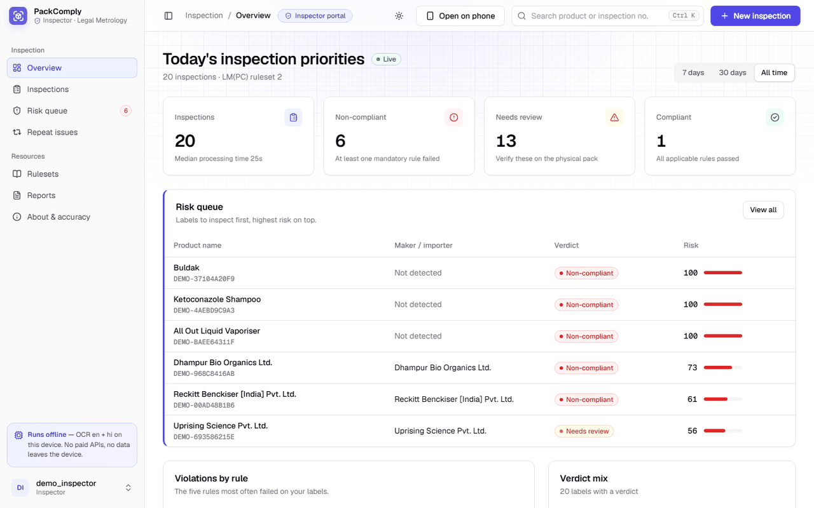
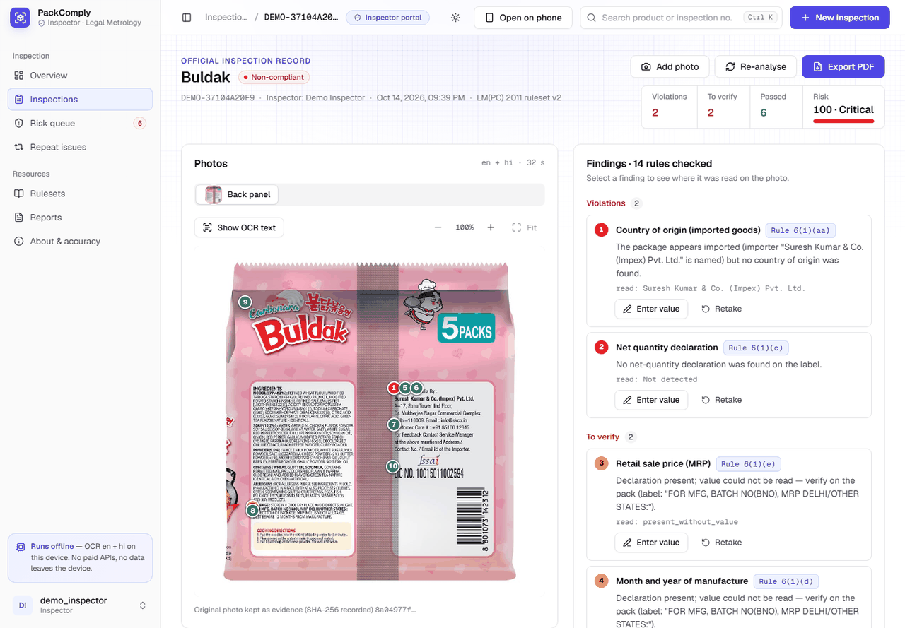
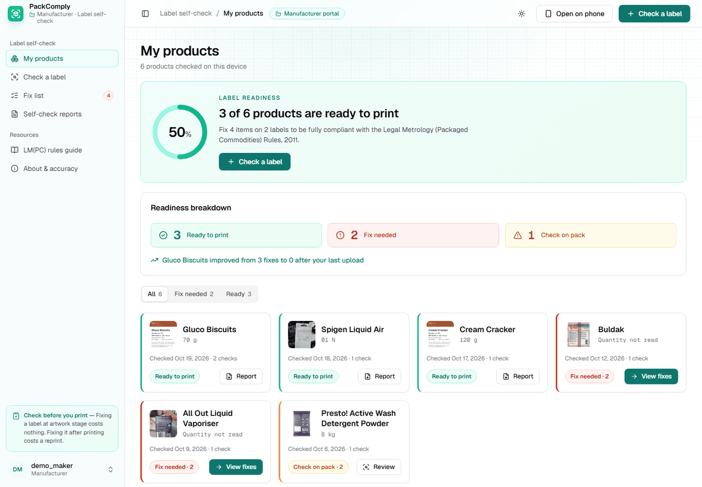
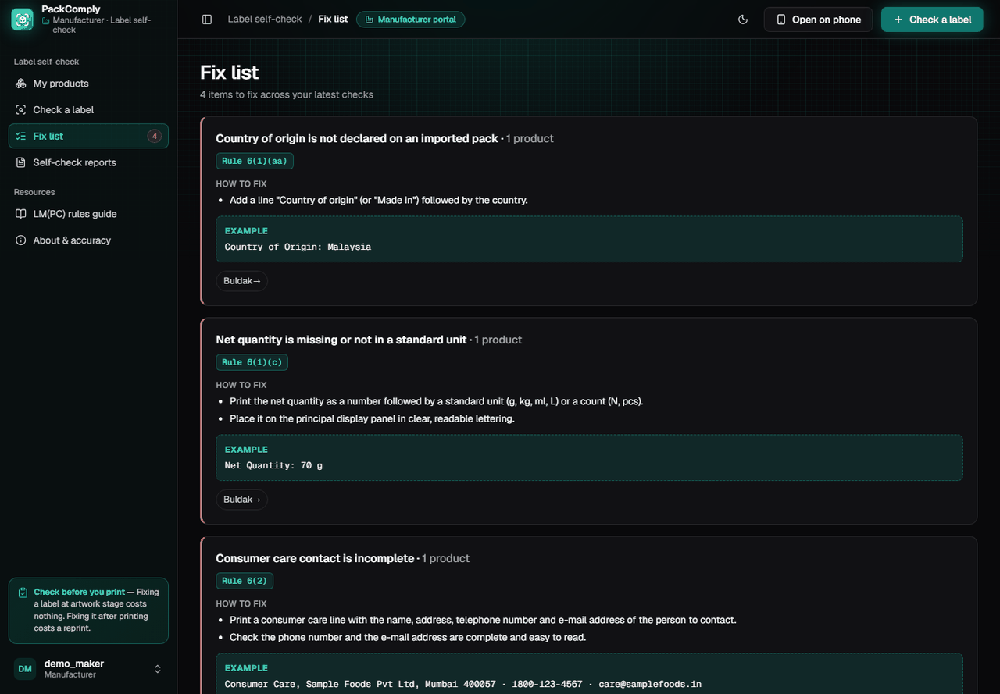
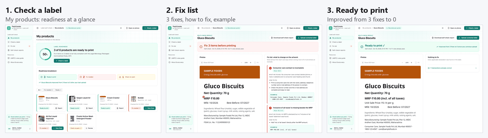
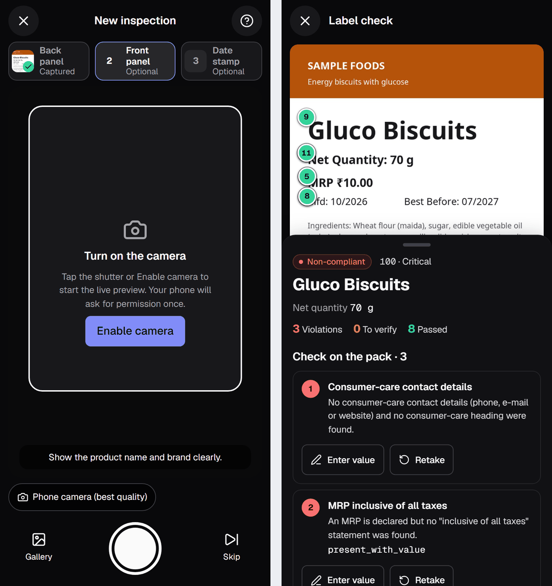
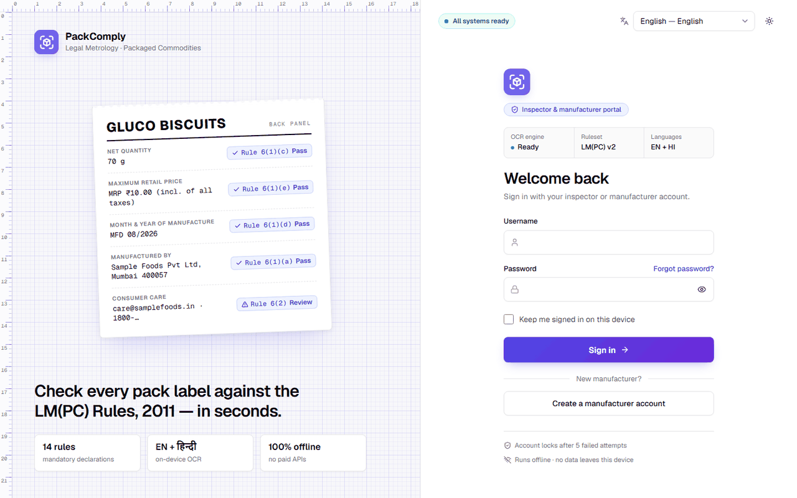
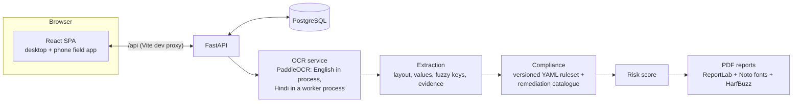
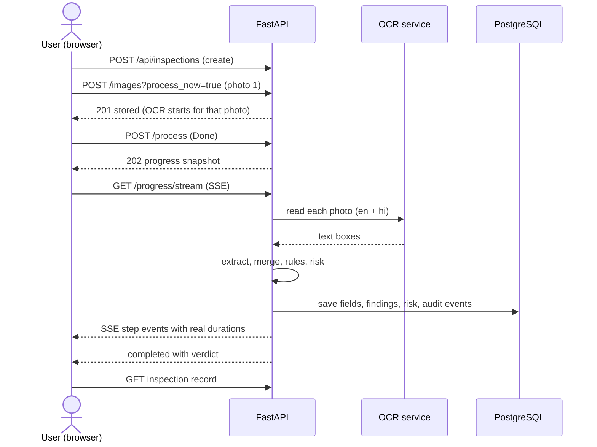

# PackComply

**Offline, AI-assisted label compliance checks under India's Legal Metrology (Packaged Commodities) Rules, 2011, for inspectors and manufacturers.**


<p align="center">
  
</p>
<p align="center"><em>Inspector portal overview: the risk queue puts the labels most worth inspecting first.</em></p>

## Contents

- [The problem](#the-problem)
- [The solution](#the-solution)
- [Two portals, one rule engine](#two-portals-one-rule-engine)
- [Key features](#key-features)
- [Demo walkthrough](#demo-walkthrough)
- [Architecture](#architecture)
- [Rules checked](#rules-checked)
- [Accuracy](#accuracy)
- [Tech stack](#tech-stack)
- [Getting started](#getting-started)
- [Usage notes](#usage-notes)
- [Testing and quality](#testing-and-quality)
- [Project structure](#project-structure)
- [Roadmap](#roadmap)
- [Limitations](#limitations)
- [Team and credits](#team-and-credits)
- [Licence](#licence)

## The problem

The Legal Metrology (Packaged Commodities) Rules, 2011 (LM(PC) Rules) require every pre-packed commodity to carry a set of mandatory declarations: the name and address of the manufacturer, packer or importer, the common name of the commodity, the net quantity in a standard unit, the maximum retail price (MRP) inclusive of all taxes, the month and year of manufacture or packing, consumer-care contact details, the unit sale price where it applies, and the country of origin for imported goods.

Checking these by hand means reading small print on curved or glossy packs, in more than one script, and comparing each declaration with the rules. It is slow and repetitive, so an inspector can only look at so many packs, and an error can go unnoticed until the pack is already on a shelf. Manufacturers face the mirror problem: a label error found after printing means a reprint.

## The solution

PackComply turns one or more photos of a pack into a checked, explainable result. Everything runs on the user's own machine.

- **Photo to text.** On-device OCR with PaddleOCR reads English and Hindi. No image leaves the device.
- **Layout-aware extraction with evidence.** Values (MRP, net quantity, maker, dates, consumer care and more) are linked to their keys using position and fuzzy matching. Each value keeps the exact text and boxes it came from, shown as numbered markers on the photo.
- **Rule engine with legal references.** A versioned YAML ruleset of 14 rules gives each finding PASS, FAIL, REVIEW or NOT_APPLICABLE and cites the rule it comes from, then rolls the findings up into a verdict (COMPLIANT, NEEDS_REVIEW or NON_COMPLIANT) and a transparent 0-100 risk score.
- **Human in the loop.** Inspectors correct a mis-read value, verify the record and get an audit trail of who changed what. When the tool is unsure it says REVIEW; it does not accuse.
- **Reports.** An official inspection PDF for inspectors and a pre-market self-check PDF for manufacturers, both with Hindi text rendered correctly.

PackComply assists people. It is not legal advice and its output is not an enforcement decision.

## Two portals, one rule engine

The role chosen at sign-in decides which product you see. Both portals use the same OCR, extraction and rule engine, and every record is scoped to its owner.

| | Inspector portal | Manufacturer portal |
|---|---|---|
| Purpose | Inspect packs in the field or at the desk and decide what needs follow-up | Check label artwork before printing and fix problems early |
| Colour | Indigo | Teal |
| Home page | Overview: "Today's inspection priorities" with KPI tiles, risk queue, violations by rule, repeat issues | My products: readiness ring, counters and one card per product |
| Key actions | New inspection (desktop or phone), correct a value, verify, add or retake a photo, re-analyse | Check a label (image or PDF), work through the fix list, upload a corrected label, download the self-check report |
| Outputs | Official record with evidence markers and audit trail, risk score, official PDF | Fix list with how-to-fix text and an example per rule, "Ready to print" state, self-check PDF (a self-assessment aid, not an approval) |

<p align="center">
  
</p>
<p align="center"><em>Inspector record: select a finding and the matching evidence box lights up on the photo.</em></p>

<p align="center">
  
</p>
<p align="center"><em>Manufacturer portal "My products": what is ready to print and what still needs a fix.</em></p>

<p align="center">
  
</p>
<p align="center"><em>Manufacturer fix list (dark theme): problem, rule, how to fix, and a sample declaration to copy.</em></p>

## Key features

**Inspection and evidence**
- Up to four photos per inspection (back, front, date stamp, other), read once each and merged field by field; when photos disagree on a value a rule depends on, the rule becomes REVIEW.
- Numbered evidence markers on the photo, with the exact text OCR read.
- Inspector corrections are validated with the extractor's own parsers; the verdict and risk update immediately and OCR is not repeated.
- Verification by an inspector and a full audit trail (photo SHA-256, OCR time, ruleset version, corrections, verification).
- Risk queue, repeat-issue detection, searchable history, official PDF report.

**Manufacturer self-check**
- Upload artwork as PNG, JPEG or PDF (first page only, rendered locally).
- Fix list with plain-language problem, rule reference, how to fix and an example, from a remediation catalogue that covers every rule.
- Upload a corrected label to see "Improved from 3 fixes to 0"; self-check report as PDF.

**Field app on a phone**
- Camera capture with sharpness, light and glare checks; falls back to the phone's own camera app or the gallery.
- Each photo is uploaded and read while the next one is framed; live progress with real step durations.
- Result screen with verdict, findings and one-tap corrections.

**Accuracy and safety**
- No false accusations by design: a mandatory declaration that cannot be read is REVIEW, not FAIL, unless the photo was read well enough to be sure it is absent.
- The manufacture date is never FAIL when not visible.
- The evaluation counts verdict-safety errors explicitly (see [Accuracy](#accuracy)).

**Security**
- Cookie-based sessions with two roles, login lockout after repeated failures, optional "keep me signed in".
- Offline password reset: an administrator issues a one-time code with a CLI; no e-mail or SMS service is needed.
- Records are scoped to their owner; role checks reject cross-role access.

**Accessibility and i18n**
- 23 UI languages loaded on demand, light and dark themes, reduced-motion support, keyboard shortcuts.
- OCR languages are separate from UI languages (English and Hindi by default).

**Offline and privacy**
- OCR, extraction, rules, PDFs and the database all run locally. No paid APIs and no cloud calls while it runs.

## Demo walkthrough

Two flows, using the seeded demo data (see [Getting started](#getting-started)). The full 5-minute script with fallbacks is in [docs/DEMO.md](docs/DEMO.md).

**Inspector**
1. Sign in to the Inspector portal and open **Overview**.
2. Press **+ New inspection** (on a phone this opens the field app).
3. Photograph the **back**, then optionally the **front** and the **date stamp**.
4. Watch live progress: text reading per photo, linking, rules, risk.
5. Read the result and open the record.
6. Correct a mis-read value (for example the MRP), with a reason; verdict and risk update.
7. Point out a hidden violation and its legal reference.
8. **Verify** the record and download the **official PDF**.

**Manufacturer**
1. Sign in to the Manufacturer portal and open **My products**.
2. Choose **Check a label** and upload artwork (image or PDF).
3. Read the **Fix list**: problem, how to fix, example; use **Show on label**.
4. **Upload corrected label**.
5. See **Ready to print** and the improvement.
6. Download the **self-check report**.

<p align="center">
  
</p>
<p align="center"><em>Manufacturer flow: My products, fix list for the draft label, and the corrected label.</em></p>

<p align="center">
  
</p>
<p align="center"><em>Field app at 390 px: capture, then the result.</em></p>

<p align="center">
  
</p>
<p align="center"><em>Sign-in page, with a live system status strip.</em></p>

## Architecture



One inspection, from upload to verdict:



Deep detail (OCR language handling, extraction passes, rule semantics, risk scoring) is in [docs/ARCHITECTURE.md](docs/ARCHITECTURE.md).

## Rules checked

The active ruleset is `LM_PC_2011` version 2, defined in [lm_pc_2011_v2.yaml](backend/app/services/compliance/rulesets/lm_pc_2011_v2.yaml). Rule titles and references below are taken from that file. Each rule's logic is a Python function in [rule_engine.py](backend/app/services/compliance/rule_engine.py).

| Rule ID | What it checks | Legal reference | Severity |
|---|---|---|---|
| `MANUFACTURER_INFORMATION` | Manufacturer / packer name and address | LM(PC) Rules 2011, Rule 6(1)(a) | HIGH |
| `IMPORTER_INFORMATION` | Importer name and address | LM(PC) Rules 2011, Rule 6(1)(a) | HIGH |
| `COUNTRY_OF_ORIGIN` | Country of origin (imported goods) | LM(PC) Rules 2011, Rule 6(1)(aa) | HIGH |
| `PACKER_INFORMATION` | Separate packer details | LM(PC) Rules 2011, Rule 6(1)(a) | INFO |
| `PRODUCT_IDENTITY` | Common or generic name of the commodity | LM(PC) Rules 2011, Rule 6(1)(b) | WARNING |
| `NET_QUANTITY_FORMAT` | Net quantity declaration | LM(PC) Rules 2011, Rule 6(1)(c) and Rule 9 | HIGH |
| `NET_QUANTITY_UNIT_SUITABILITY` | Net quantity unit suits the commodity | LM(PC) Rules 2011, Rule 9 and Fourth Schedule | INFO |
| `MRP_FORMAT` | Retail sale price (MRP) | LM(PC) Rules 2011, Rule 6(1)(e) | HIGH |
| `MRP_TAX_INCLUSIVE` | MRP inclusive of all taxes | LM(PC) Rules 2011, Rule 6(1)(e) | WARNING |
| `UNIT_SALE_PRICE` | Unit sale price | LM(PC) Rules 2011, Rule 6(11) (as amended 2022) | WARNING |
| `MANUFACTURE_DATE` | Month and year of manufacture | LM(PC) Rules 2011, Rule 6(1)(d) | WARNING |
| `DATE_CONSISTENCY` | Date consistency | LM(PC) Rules 2011, Rule 6(1)(d) | WARNING |
| `CONSUMER_CARE_FORMAT` | Consumer-care contact details | LM(PC) Rules 2011, Rule 6(2) | WARNING |
| `FSSAI_LICENSE_PRESENT` | FSSAI licence number (food cross-check) | FSS (Labelling and Display) Regulations 2020 — cross-check, not LM(PC) | INFO |

The FSSAI row is a cross-check on food labels, not an LM(PC) rule. Findings are inspection assistance based on one label photo; an inspector must confirm every finding on the physical package.

## Accuracy

All figures come from [evaluation_report.json](backend/app/assets/evaluation_report.json), which is also what the in-app "About & accuracy" page shows.

**Run `development-2026-10`, kind: development, generated 2026-10-19, ruleset LM_PC_2011 v2 (14 rules).**

| Measure | Development score (23 labelled photos) |
|---|---|
| Field precision | 96.3% (438 fields scored) |
| Field recall | 83.4% |
| Rule agreement | 290 of 322 (90.1%) |
| Verdict accuracy | 17 of 23 (73.9%) |
| False NON_COMPLIANT verdicts | 0 |
| False PASS on mandatory rules | 0 |
| Median processing time | 23.62 s per photo (max 105.18 s, 23 photos) |

| Dataset | Photos |
|---|---|
| Development | 23 (of which 14 phone photos retired from hold-out to development on 2026-10-16) |
| Unseen | **0** |

**How to read this.** These are **development scores**, not unseen scores: extraction was tuned while looking at these photos, so they are optimistic. No unseen score exists yet; the repository has the tooling and procedure to produce one ([docs/EVALUATION.md](docs/EVALUATION.md)): photos are labelled by hand before the pipeline sees them, the set is evaluated once, and extraction is not tuned in response. A hold-out split was used earlier, but both hold-outs were retired into development after their failures were inspected.

**Known weak spots in the report:** product-name recall is 9 of 19, and manufacturing-date recall is 6 of 9. The 6 verdict disagreements in the development set are all labels the ground truth rates COMPLIANT that PackComply marks NEEDS_REVIEW, i.e. the safe direction.

## Tech stack

| Layer | Technology | Why | Licence |
|---|---|---|---|
| Frontend | React 19, TypeScript, Vite | Typed SPA with fast dev server and a built-in `/api` proxy | MIT |
| Backend | Python 3.12, FastAPI, Pydantic | Typed API with automatic docs | MIT |
| Database | PostgreSQL 16, SQLAlchemy, Alembic | Reliable local database with versioned migrations | PostgreSQL licence; MIT |
| OCR | PaddleOCR / PaddlePaddle, OpenCV | Strong open-source OCR that runs on CPU, English and Hindi | Apache-2.0; Apache-2.0 |
| PDF reports | ReportLab, uharfbuzz (HarfBuzz), Noto Sans and Noto Sans Devanagari | Correct Hindi shaping in reports | BSD; MIT; SIL OFL |
| PDF artwork | pypdfium2 (PDFium) | Render page 1 of a PDF locally | Apache-2.0 / BSD-3-Clause |
| Rules | YAML (PyYAML) | Rule metadata separate from code, versioned | MIT |
| Tests | pytest, Vitest, Testing Library | Backend and UI coverage | MIT |
| Dev ops | Docker, Docker Compose (optional) | Alternative to a local PostgreSQL | |

Everything is free and open source and runs locally. Licences are as published by each project; check them before redistributing.

## Getting started

### Prerequisites

- Python 3.12 (3.11 to 3.13 work; PaddlePaddle has no wheels for newer releases)
- Node.js 20 or newer (developed with Node 24) and npm
- PostgreSQL 16 (the EDB zip binaries need no installer; see [docs/local-setup-windows.md](docs/local-setup-windows.md))
- Windows 11 is the primary target. Note that Windows Smart App Control can block unsigned developer tools (for example the PostgreSQL binaries or Node add-ons); if something fails to start, check that setting first.

### Install

```powershell
git clone https://github.com/rishibhaskar777/PackComply.git
cd PackComply
py -3.12 -m venv .venv
.\.venv\Scripts\Activate.ps1
pip install -e ".[dev]"
cd frontend; npm install; cd ..
Copy-Item .env.example .env
```

Edit `.env` (never commit it). The important variables:

| Variable | Default | Meaning |
|---|---|---|
| `DATABASE_URL` | `postgresql+psycopg://packcomply:<password>@localhost:5432/packcomply` | Database connection; set your own password |
| `UPLOAD_DIR` | `uploads` | Where evidence photos are stored |
| `MAX_UPLOAD_BYTES` | `10485760` | Upload size limit (10 MB) |
| `OCR_LANGUAGES` | `en,hi` | OCR languages (each extra language adds time) |
| `OCR_PANEL_LANGUAGES` | `DATE_STAMP=en;BACK=en+hi;FRONT=en+hi;OTHER=en+hi` | Languages read per photo panel |
| `OCR_MAX_IMAGE_DIMENSION` | `1280` | Longest side photos are resized to for OCR |
| `OCR_WARMUP_ON_STARTUP` | `true` | Load OCR models in the background at start |
| `SESSION_TTL_HOURS` / `SESSION_REMEMBER_DAYS` | `12` / `30` | Sign-in lifetime without and with "Keep me signed in" |
| `SESSION_SECURE` | `false` | Set `true` when served over HTTPS |
| `LOGIN_MAX_ATTEMPTS` / `LOGIN_LOCKOUT_MINUTES` | `5` / `15` | Lockout policy |
| `ALLOW_OFFICIAL_SELF_REGISTRATION` | `false` | Whether anyone may self-register as an inspector (demos only) |
| `CORS_ORIGINS` | `http://localhost:5173,http://127.0.0.1:5173` | Allowed browser origins |
| `LAN_IP` / `PHONE_URL` | empty (auto-detected) | Override the address shown for phone access |

Create the database (PostgreSQL running; use the same password as in `.env`), then migrate and create a user:

```powershell
psql -U postgres -h localhost -c "CREATE ROLE packcomply WITH LOGIN PASSWORD '<your-password>';" -c "CREATE DATABASE packcomply OWNER packcomply;"
alembic -c backend/alembic.ini upgrade head
python -m backend.scripts.create_user --role OFFICIAL       # prompts for username, e-mail, password
python -m backend.scripts.warm_ocr                          # optional: download OCR models once
python -m backend.scripts.seed_demo                         # optional: demo accounts and data
```

`seed_demo` creates `demo_inspector` and `demo_maker` and prints their passwords once when it creates them (or use `--inspector-password` / `--maker-password`). It looks for sample photos in folders next to the repository, or you can pass photo folders as arguments. Seeded rows can be removed with `seed_demo --reset-demo`. The first OCR run downloads the models and needs internet access once; after that it works offline.

### Start

One command (Windows PowerShell):

```powershell
powershell -ExecutionPolicy Bypass -File scripts\start-demo.ps1
powershell -ExecutionPolicy Bypass -File scripts\stop-demo.ps1
```

`start-demo.ps1` checks the virtual environment, `npm` and `node_modules` and that ports 8000 and 5173 are free; starts PostgreSQL with `pg_ctl` if it is not already running (set the two PostgreSQL paths at the top of the script); runs migrations; prints a **pre-flight summary** (database answers, migrations at head, OCR models on disk, free disk space, LAN address, firewall rule); starts the API and the HTTPS web app; waits for readiness and OCR warm-up; then prints the laptop URL, the phone URL and a QR code. Critical failures stop with the fix; a missing Wi-Fi address or firewall rule is only a warning.

Or start the two servers by hand, in two terminals:

```powershell
uvicorn backend.app.main:app --reload          # repository root, venv active
cd frontend; npm run dev                       # or: npm run dev:https
```

Open <http://localhost:5173>; API docs are at <http://localhost:8000/docs>. Docker Compose is also supported: `docker compose up --build` (see [docs/SETUP.md](docs/SETUP.md)).

### Test on a phone

The live camera preview needs HTTPS, so use the HTTPS dev mode:

1. Run `npm run dev:https` in `frontend/` (the one-command start already does this).
2. Put the phone on the **same Wi-Fi** as the laptop, or connect the laptop to the phone's hotspot.
3. Allow the dev port through Windows Firewall once, from an Administrator PowerShell: `New-NetFirewallRule -DisplayName "PackComply Demo (5173)" -Direction Inbound -Protocol TCP -LocalPort 5173 -Action Allow -Profile Any`
4. On the phone open `https://<laptop-ip>:5173`, and accept the **self-signed certificate** warning once (Advanced, then proceed).
5. Or, on the desktop, click **Open on phone** in the top bar: it shows the phone URL as a QR code drawn in the browser.

More detail, including backup and restore and troubleshooting, is in [docs/SETUP.md](docs/SETUP.md).

## Usage notes

- **Corrections and verification.** Inspectors can enter a corrected value with a reason; the verdict and risk update without repeating OCR. Verifying records who and when; a later correction returns the record to unreviewed.
- **Multi-photo panels.** Back, front, date stamp and other; adding a photo to a record reads only that photo.
- **PDF artwork upload.** Manufacturers can upload a PDF; only the first page is rendered locally. Encrypted PDFs, PDFs over 20 pages and files over the upload limit are rejected with a clear message. Inspector uploads are image-only.
- **Password reset.** `python -m backend.scripts.reset_password --username <name>` prints a one-time 6-digit code valid for 15 minutes; add `--set-password` to set a password directly.
- **Backups.** `scripts\backup-db.ps1` writes a database dump (and a zip of the stored photos); `scripts\restore-db.ps1 -File <dump>` restores it after a typed confirmation.
- **Evaluation.** `python -m backend.scripts.eval_extraction`, `eval_compliance` and `eval_real` score the stored fixtures; `batch_evaluate` runs the full pipeline on a folder of photos; `scripts\run-unseen-eval.ps1` runs the one-shot unseen evaluation. Procedure in [docs/EVALUATION.md](docs/EVALUATION.md).
- **Reanalyse.** After improving extraction, `python -m backend.scripts.reanalyse_all` re-runs extraction and rules on stored OCR without repeating OCR.

## Testing and quality

```powershell
pytest backend/tests          # 666 tests
cd frontend; npm test         # 626 tests in 37 files (Vitest)
cd frontend; npm run verify:auth-locales
```

Latest local run: **666 backend and 626 frontend tests passed (1292 in total)**. The backend suite covers the rule engine and every rule, extraction on labelled OCR fixtures (synthetic and real), the API and role scoping, authentication and password reset, multi-photo merging, PDF upload and reports, risk scoring, seeding and evaluation reports. The frontend suite covers the portals, capture flow, record and fix-list pages, progress handling, i18n and image utilities; the locale tests check that every language file has every key and that placeholders and product terms survive translation. The remediation catalogue is tested to cover every rule in the active ruleset.

## Project structure

```text
backend/
  app/
    api/                 HTTP routes (auth, inspections, products, dashboard, risk, system ...)
    core/                Settings, database, security, start-up checks
    models/ schemas/     SQLAlchemy models and Pydantic schemas
    services/
      ocr/               PaddleOCR service and workers
      extraction/        Layout, value-first linking, fuzzy keys, evidence
      compliance/        Rule engine and rulesets/ (versioned YAML + remediation)
      risk.py report.py self_check_report.py workflow.py ...
    assets/              Fonts (Noto) and evaluation_report.json
  alembic/               Database migrations
  scripts/               create_user, seed_demo, reset_password, evaluation tools ...
  tests/                 pytest suite and labelled OCR fixtures
frontend/
  src/                   React app: pages/ (inspector, maker, capture), components/, locales/ (23 languages)
scripts/                 start-demo, stop-demo, backup-db, restore-db, run-unseen-eval (PowerShell)
demo/artwork/            Synthetic label artwork used by the demo
docs/                    SETUP, DEMO, EVALUATION, ARCHITECTURE, screenshots/
```

## Roadmap

- Native-speaker review of the 21 machine-assisted translations.
- Rules for drug and medical-device labels, and more rulesets and amendments.
- Packaging for easier deployment (Docker images are provided for the stack, but a polished installer is not).
- Move OCR to a process pool so the API stays responsive while photos are being read.
- Mobile PWA with an offline queue for uploads.
- A real unseen-photo evaluation run.

## Limitations

- OCR on CPU takes about 20 s per photo (median 23.6 s in the development run).
- Glossy or curved labels, and low light or glare, reduce reading quality.
- Prices and dates stamped separately on the pack are often not linked; PackComply marks these REVIEW.
- Product-name extraction from front panels is the weakest field (see [Accuracy](#accuracy)); an empty name is preferred to a wrong one.
- The self-check report is a self-assessment aid, not an official approval.
- 21 of the 23 UI translations are machine-assisted and need native-speaker review. OCR supports fewer languages than the UI.
- No unseen-set accuracy figure exists yet; the published scores are development scores.


## Author

**Rishi Bhaskar** ([@rishibhaskar777](https://github.com/rishibhaskar777)): design, development, evaluation and maintenance of PackComply, built for InnoTech'26.

PackComply started from an early prototype and has since been substantially redesigned and rebuilt: the OCR pipeline, layout-aware extraction, versioned rule engine with legal references, risk scoring, inspector and manufacturer portals, phone field app, evaluation framework and UI.

Built on open-source software: PaddleOCR and PaddlePaddle, FastAPI, React, Vite, SQLAlchemy and Alembic, PostgreSQL, ReportLab, HarfBuzz (via uharfbuzz), pypdfium2, OpenCV, Noto fonts (SIL Open Font License), Geist fonts, lucide icons and Motion.

## Licence

Not yet licensed. All rights reserved.
